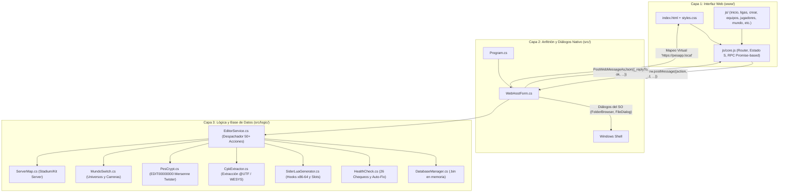

# ANÁLISIS TÉCNICO EXHAUSTIVO: PES 2021 EDITOR PRO (NUEVA APP WEB)
**Ubicación analizada:** `<carpeta-del-programa>`  
**Arquitectura:** Híbrida WinForms (.NET 4.0) + WebView2 (Chromium Evergreen) + Vanilla JavaScript (ES6/ES5 seguro)  
**Autor:** EXEVAZ27  
**Fecha de Auditoría:** 30 de Octubre de 2026  

---

## 1. RESUMEN EJECUTIVO Y ARQUITECTURA GLOBAL

La nueva aplicación en `<carpeta-del-programa>` representa una **evolución arquitectónica radical y exitosa** respecto a la versión anterior de WinForms. Resuelve de raíz los problemas de acoplamiento de interfaz, diseño rígido y pérdida de controles mediante una separación limpia en 3 capas:

### El Protocolo de Comunicación (RPC)
- **Mensaje JS -> C#**: `window.chrome.webview.postMessage({ action: "nombreAccion", _id: 123, ...payload })`.
- **Despacho en C#**: `WebHostForm.OnWebMessage` deserializa mediante `JavaScriptSerializer` de alta capacidad (`MaxJsonLength = int.MaxValue`). Si es un diálogo de explorador (`pickFolder`, `pickFile`, `saveFile`), lo atiende la ventana nativa; si es lógica de negocio, lo deriva a `EditorService.Handle(action, msg)`.
- **Respuesta C# -> JS**: Devuelve `{ _replyTo: 123, type: "nombreAccionResult", ok: true/false, ...datos }`. En JavaScript, `rpc()` devuelve una `Promise` que se resuelve o rechaza según el campo `ok`.

---

## 2. ANÁLISIS CARPETA POR CARPETA Y ARCHIVO POR ARCHIVO

### A. Raíz de la Aplicación (`<carpeta-del-programa>`)

| Archivo | Tamaño | Propósito y Funcionamiento Técnico |
| :--- | :--- | :--- |
| **`PES2021EditorWeb.exe`** | 536 KB | Binario ejecutable compilado. Contiene todo el código de `src/` y `src/logic/` unificado en un solo ensamblado de 64 bits optimizado. |
| **`compilador-web.bat`** | 1.4 KB | Script de compilación desatendido. Invoca directamente `csc.exe` de `.NET Framework 4.0/4.8` (`Framework64\v4.0.30319`) con flags `/optimize+` y `/unsafe`. Enlaza las DLLs de WebView2, compresión de sistema y JavaScript. |
| **`editor_config.json`** | 443 B | Archivo JSON de configuración central. Guarda las rutas: `GameFolder`, `SiderFolder`, `LiveCpkFolder`, `ModulesFolder`, `ContentFolder`, `PesdbFolder` y `EditFile`. |
| **`API-LOGICA.txt`** | 10.4 KB | Documento de mapeo de clases y signaturas de `DatabaseManager.cs` y `PesDbModel.cs`. |
| **`Microsoft.Web.WebView2.Core.dll`** | 703 KB | Ensamblado oficial de Microsoft que gestiona el ciclo de vida del motor Edge/Chromium. |
| **`Microsoft.Web.WebView2.WinForms.dll`** | 38.7 KB | Control de Windows Forms para alojar el navegador WebView2 dentro del formulario. |
| **`WebView2Loader.dll`** | 194 KB | Cargador nativo x64 de la biblioteca de enlace dinámico de WebView2. |
| **`PES2021EditorWeb.exe.WebView2/`** | Directorio | Carpeta de caché de datos de usuario de WebView2 (cookies locales, almacenamiento de sesión y estado de GPU). |
| **`docs/`** | Directorio | Contiene los 5 documentos maestros de investigación: `DOCUMENTACION_INGENIERIA_INVERSA_PES2021.md`, `auditoria_matozanato_hoja_de_ruta.md`, `estructura_binaria.md`, `ingenieria_inversa_exe.md` y `paquetes_modulares_pesleague.md`. |

---

### B. Capa Host de C# (`src/`)

#### 1. [Program.cs](file:///E:/app-web/src/Program.cs) (19 líneas)
- **Función:** Punto de entrada estándar Win32 (`[STAThread]`).
- **Comportamiento:** Habilita estilos visuales modernos y lanza la instancia de `WebHostForm`.

#### 2. [WebHostForm.cs](file:///E:/app-web/src/WebHostForm.cs) (166 líneas)
- **Función:** Formulario nativo de pantalla completa (1360×860 px, mínimo 1080×660 px) que alberga el control `WebView2`.
- **Mecanismos clave:**
  - `SetVirtualHostNameToFolderMapping("pesapp.local", www, Allow)`: Mapea la carpeta `www` a un esquema seguro `https://pesapp.local/`, eliminando los bloqueos de seguridad de CORS y orígenes locales `file://`.
  - Deshabilita menús contextuales por defecto (`AreDefaultContextMenusEnabled = false`) y barras de estado para brindar apariencia de aplicación de escritorio pura.
  - Implementa los diálogos del sistema:
    - `pickFolder`: `FolderBrowserDialog` con ruta inicial configurable.
    - `pickFile` y `saveFile`: `OpenFileDialog` y `SaveFileDialog` con filtros de extensión.
  - Puerta de enlace hacia acciones de archivo complejas: exportación/importación de paquetes de liga `.pesleague`, CSV de equipos y bloques de datos EDIT (`data.dat`).

#### 3. [EditorService.cs](file:///E:/app-web/src/EditorService.cs) (2.285 líneas)
- **Función:** Es el **cerebro del backend**. Transforma solicitudes JSON en llamadas a la lógica de PES y devuelve DTOs limpios y estructurados.
- **Manejo de Acciones (Switch de 50+ casos):**
  - **Estado y Configuración:** `getState`, `getHealth`, `saveConfig`, `deriveFromGame`, `scanEditFiles`, `detectGames`, `extractPesdb`.
  - **Base de Datos:** `loadDb`, `saveDb` (guarda en disco y sincroniza automáticamente a `livecpk/PruebaLigas/common/etc/pesdb` creando respaldos previos).
  - **Competiciones:** `listCompetitions`, `getCompetition`, `updateCompetition`, `deleteCompetition`, `createLeagueOptions`, `createLeague`, `addTeamToCompetition`, `removeTeamFromCompetition`, `compEmblem`, `setCompEmblemFile`.
  - **Equipos:** `listTeams`, `getTeam`, `updateTeam`, `createTeam`, `cloneTeam`, `deleteTeam`, `batchCreateTeams`, `generateTeams`, `assignTeamToLeague`, `applyFormation`, `teamEmblem`, `setTeamEmblemFile`.
  - **Plantillas y Jugadores:** `getRoster`, `setShirtNumber`, `transferPlayer`, `releasePlayer`, `signFreeAgent`, `autoAssignRoles`, `freeAgents`, `listPlayers`, `getPlayer`, `updatePlayer`, `createPlayer`, `clonePlayer`, `deletePlayer`, `playerMiniface`.
  - **Pirámide y Ecosistema Sider:** `getPyramids`, `getSider`, `setSiderModule`, `deploySider`, `saveLua`, `getLuaPreview`, `getWorldTxt`, `listRestorePoints`, `createRestorePoint`, `restoreRestorePoint`, `listProfiles`, `saveProfile`, `applyProfile`, `deleteProfile`, `fixHealthItem`.
  - **Mundos (Universos):** `getWorld`, `registerWorld`, `listWorlds`, `createWorld`, `switchWorld`, `deleteWorld`, `renameWorld`.
  - **Servidores de Contenido:** `getServerMap`, `setServerMapEntry`, `removeServerMapEntry`, `listTeamOptions`.
  - **Censo y Generadores:** `getCensus`, `listPresets`, `previewPreset`, `applyPreset`, `previewSquad`, `applySquad`, `previewNewLife`, `applyNewLife`, `previewCsvPlayers`, `applyCsvPlayers`.
  - **Archivo EDIT:** `editLoad`, `editSave`, `editSetDescription`, `editSetSid`, `editUnlock`, `editInspectFl26`, `editRestoreBackup`.

---

### C. Módulos de Lógica de Bajo Nivel (`src/logic/`)

#### 1. [DatabaseManager.cs](file:///E:/app-web/src/logic/DatabaseManager.cs) (4.935 líneas)
- **Función:** Motor de persistencia y relaciones binarias en memoria.
- **Estructuras gestionadas:** `Competitions`, `Regulations`, `Entries`, `Teams`, `Players`, `PlayerAssignments`, `Tactics`, `TacticsFormations`, `Coaches`, `Stadiums`, `Countries`, `Derbies`.
- **Seguridad en Escritura:**
  - Implementa `CreateTimestampedBackup(folderPath)` antes de tocar ningún archivo.
  - **Guardado Atómico en 2 Fases:** Serializa y comprime en memoria (`staged`) todos los `.bin`; solo si todos se serializan con éxito, escribe a disco reemplazando de forma atómica.
  - Manejo de reglas de torneos y Liga Máster (ascensos/descensos, tipos de temporada europea o año calendario, copas vinculadas).

#### 2. [PesDbModel.cs](file:///E:/app-web/src/logic/PesDbModel.cs) (1.080 líneas)
- **Función:** Define los modelos de datos y la decodificación binaria de cada registro de Konami:
  - `CompetitionRecord` (16 bytes): ID, orden, continente.
  - `RegulationRecord` (136 bytes): Nombres multilingües (español, inglés, latam, ascii), aforo de equipos, tipo de competición, sustituciones, reglas de prórroga, penales, gol de visitante, liguilla final.
  - `EntryRecord` (8 bytes): Asociación de `TeamId` con `CompetitionId`.
  - `TeamRecord` (1.532 bytes): Nombres, bandera de país, ID de estadio, ID de entrenador, rivales históricos, banderas nacional/club.
  - `PlayerRecord` (116 bytes + raw data): Valoración general, edad, pierna hábil, altura, peso, nacionalidad y habilidades.
  - `TacticsRecord` y `TacticsFormationRecord`: Formaciones de juego, coordenadas tácticas en el campo y roles.

#### 3. [CpkExtractor.cs](file:///E:/app-web/src/logic/CpkExtractor.cs) (529 líneas)
- **Función:** Extracción limpia de archivos de base de datos desde los `.cpk` originales del juego (`dt10_x64.cpk`, `dt33_g4.cpk`, parches).
- **Ingeniería Inversa:**
  - Des-enmascaramiento de tablas CRI `@UTF` mediante algoritmo XOR con máscara evolutiva (`0x5F`, factor multiplicador `0x15`).
  - Extracción directa a memoria de los 16 archivos `.bin` y descompresión automática mediante `WesysCompressor`.

#### 4. [SiderLuaGenerator.cs](file:///E:/app-web/src/logic/SiderLuaGenerator.cs) (1.230 líneas)
- **Función:** Ensambla dinámicamente el script `league_manager.lua` para Sider.
- **Opcodes e Inyecciones de Memoria:**
  - Contiene las direcciones reales de memoria x86-64 descubiertas en el desensamblado de `PES2021.exe`:
    - Dirección base de tabla de competiciones: `0x1434FDF00`.
    - Sitios de instrucciones LEA (`LEAS`): `0x1414FDBDA`, `0x1414FDD71`, `0x1414FDE07`.
    - Contadores de bucle nativos (`COUNT_SITES`): `0x1414FDC4A`, `0x1414FDD60`, `0x1414FDE1B`, `0x1414FE1E0`.
  - Inyecta la reserva de memoria con `VirtualAlloc` para expandir la tabla nativa a **250 slots concurrentes**.
  - Instala los **11 Null-Guards (ganchos anti-cuelgues)** para interceptar accesos nulos fuera del rango vanilla.
  - Genera el descriptor de Liga Máster `fl26world.txt` con los calendarios y cadenas de ascenso/descenso.

#### 5. [HealthCheck.cs](file:///E:/app-web/src/logic/HealthCheck.cs) (782 líneas)
- **Función:** Sistema de diagnóstico automatizado de 26 puntos.
- **Grupos auditados:**
  - `R1..R6` (Rutas): Presencia de `PES2021.exe`, carpetas de Sider (`livecpk`, `modules`, `content`), pesdb con los binarios mínimos requeridos y archivo EDIT.
  - `S1..S5` (Sider.ini): Verificación de existencia, detección y alerta de **BOM UTF-8** (que anula Sider), estado de `luajit.ext.enabled = 1`, módulo `league_manager.lua` y directiva `cpk.root`.
  - `D1..D6` (Despliegue): Existencia y coherencia del script Lua y módulos auxiliares.
  - `P1..P3` (Paquete livecpk): Coherencia entre la pesdb de trabajo y el livecpk.
  - `L1..L4` (Log de Sider): Lectura en vivo de `sider.log` para confirmar si los hooks engancharon en memoria sin errores.
  - `B1..B5` (Base): Integridad de registros, equipos sin jugadores o duplicados.
  - `E1..E2` (EDIT): Validación de tamaño y descifrado de opciones.
- **Auto-Fix:** Implementa la rutina `FixHealthItem` para corregir con 1 solo clic los errores más comunes (limpiar BOM de sider.ini, crear carpetas faltantes, sincronizar paquete).

#### 6. [MundoSwitch.cs](file:///E:/app-web/src/logic/MundoSwitch.cs) y [MundoRegistry.cs](file:///E:/app-web/src/logic/MundoRegistry.cs) (500 líneas)
- **Función:** Implementa el concepto de **Universos Independientes ("Mundos")**.
- **Mecanismo:**
  - Cada "Mundo" posee su propia copia de `pesdb` y su propia carpeta de partidas guardadas de KONAMI (`save` <-> `save_mundoX`).
  - Al cambiar de mundo, la aplicación guarda la foto del mundo saliente, intercambia atómicamente la carpeta de guardado y recarga la nueva base, permitiendo tener una Liga Argentina con Primera B en un mundo y un juego europeo o clásico en otro sin pisarse jamás.

#### 7. [ServerMap.cs](file:///E:/app-web/src/logic/ServerMap.cs) (208 líneas)
- **Función:** Edición quirúrgica declarativa de mapas de Sider (`stadium-server/map_teams.txt` y `kit-server/map.txt`).
- **Disciplina:** Preserva terminadores de línea exactos (CRLF/LF), comentarios y líneas existentes, generando copias `.bak` antes de escribir.

#### 8. [PesCrypt.cs](file:///E:/app-web/src/logic/PesCrypt.cs) (666 líneas)
- **Función:** Motor criptográfico basado en Mersenne Twister MT19937 (32 bits) para descifrar y cifrar archivos `EDIT00000000`. Permite leer la configuración, transferencias del usuario y **desbloquear el guardado para el SID de Windows actual**.

#### 9. [LeaguePackageManager.cs](file:///E:/app-web/src/logic/LeaguePackageManager.cs) (952 líneas)
- **Función:** Generación e importación de contenedores `.pesleague` (formato ZIP con `manifest.json`, escudos, formaciones y datos de equipos en Base64). Permite compartir ligas creadas con reasignación automática de IDs si hay colisiones.

#### 10. [PresetEngine.cs](file:///E:/app-web/src/logic/PresetEngine.cs), [SquadGenerator.cs](file:///E:/app-web/src/logic/SquadGenerator.cs), [CsvImporter.cs](file:///E:/app-web/src/logic/CsvImporter.cs) y [NewLifeImporter.cs](file:///E:/app-web/src/logic/NewLifeImporter.cs)
- **PresetEngine:** Lee recetas de pirámides reales por país y las contrasta con el censo de la base cargada sin tocar nada hasta que el usuario confirma.
- **SquadGenerator:** Generador de plantillas balanceadas. Ficha automáticamente agentes libres para completar planteles cortos (23 jugadores: 3 arqueros, 40% defensores, 35% volantes, 25% delanteros), asigna dorsales, esquema 4-2-3-1 y roles de capitán/tiros libres.
- **CsvImporter & NewLifeImporter:** Importación multiformato desde Football Manager (conversión de escala 1-20 a 1-99), EA FC / SoFIFA y paquetes NewLife.

#### 11. [ImageProcessor.cs](file:///E:/app-web/src/logic/ImageProcessor.cs), [GameEmblemProvider.cs](file:///E:/app-web/src/logic/GameEmblemProvider.cs) y [MinifaceProvider.cs](file:///E:/app-web/src/logic/MinifaceProvider.cs)
- **ImageProcessor:** Recorte automático de bordes transparentes (Auto-Trim), escalado bicúbico centrado y generación por punteros (`unsafe`) de siluetas de contraste para fondos claros y oscuros de Konami.
- **Emblem & Miniface:** Extracción de escudos oficiales desde `dt15_x64.cpk` y lectura de minifaces desde Sider o data packs.

---

### D. Interfaz Web Moderna (`www/`)

#### 1. [index.html](file:///E:/app-web/www/index.html) (84 líneas)
- **Estructura:** Barra lateral fija izquierda (`aside#sidebar`) con selector de 11 secciones, indicador reactivo de estado de base (`dot` verde/rojo con contador de ligas, equipos y jugadores), botón de guardado rápido (`btnSave`) y contenedor principal dinámico (`main#main`). Incluye sistema global de ventanas modales y notificaciones toast.

#### 2. [styles.css](file:///E:/app-web/www/styles.css) (1.050 líneas)
- **Diseño:** Tema oscuro profesional con paleta Slate/Dark Navy (`#0B0F19`, `#121826`, `#1A2234`), acentos en Cyan Eléctrico (`#00E5FF`), Dorado (`#FFD166`) y Rojo de alerta (`#EF4444`).
- **Componentes:** Grillas fluidas, paneles master-detail, chips de filtrado, badges de posiciones de fútbol coloreados según la línea (Portero, Defensa, Medio, Delantero), tarjetas de estadísticas y banners interactivos.

#### 3. Módulos JavaScript (`www/js/`)

| Archivo | Líneas | Responsabilidad en la Interfaz |
| :--- | :--- | :--- |
| **`core.js`** | 231 | Núcleo del cliente. Maneja la cola de promesas RPC, el estado global reactivo (`A.S`), el enrutador de secciones (`A.goto`), el modal del sistema, el sistema de escudos bitono dinámicos y la carga inicial sincronizada con el backend. |
| **`inicio.js`** | 177 | Pantalla de bienvenida con métricas en tiempo real, accesos directos y la pestaña de **Configuración integral de rutas** (Juego, Sider, livecpk, pesdb, EDIT y extracción CPK). |
| **`ligas.js`** | 257 | Explorador master-detail de competiciones. Permite buscar, filtrar por ligas/copas, editar nombres oficiales en 4 idiomas, modificar reglamentos y formatos, definir ascensos/descensos, vincular copas y asignar/quitar equipos. |
| **`crear.js`** | 245 | Asistente paso a paso para crear nuevas ligas independientes o divisiones subordinadas. Filtra IDs libres para evitar colisiones y permite seleccionar equipos libres o cargar presets reales con el censo de la base. |
| **`equipos.js`** | 556 | Gestor completo de clubes y selecciones. Permite editar identidades, estadios, directores técnicos, rivales clásicos, esquemas tácticos, dorsales y realizar traspasos de jugadores entre clubes o a la agencia libre. Incluye el importador masivo CSV / FM / EA FC. |
| **`jugadores.js`** | 268 | Explorador y editor de futbolistas con búsqueda en vivo, filtros por posición y rango de valoración (OVR). Ficha técnica completa con habilidades desglosadas por color, posiciones, skills especiales y carga de minifaces. |
| **`otros.js`** | 352 | Gestiona 3 pantallas clave: la **Pirámide visual** de divisiones por país; el panel de **Sider y Lua** (con control de módulos, mapas de estadios/camisetas y puntos de restauración); y el gestor del archivo **EDIT00000000** (desbloqueo, inspección y exportación). |
| **`mundo.js`** | 118 | Gestor visual de Universos / Mundos. Muestra el mundo activo, permite crear nuevos mundos (limpios o clonados), renombrar, borrar y alternar entre ellos con un solo clic. |
| **`diagnostico.js`** | 94 | Panel visual del sistema de salud (`HealthCheck`). Presenta el semáforo de estado, detalles de advertencias y el botón para ejecutar reparaciones automáticas en el Sider. |

---

## 3. CATÁLOGO DE CAPACIDADES: ¿QUÉ PUEDE HACER LA APLICACIÓN?

### 1. Gestión de Ligas y Competiciones (Sin sustitución)
- **Creación no destructiva:** Crea ligas y copas en IDs libres sin sobreescribir ninguna competición original de Konami.
- **Reglamentos a medida:** Configuración de aforo de equipos (2 a 63), cantidad de sustituciones (3, 5, 6), jugadores registrados en plantilla, rondas de ida y vuelta (1 a 4), formato de copa, prórrogas, penales y liguilla final.
- **Sistemas de Pirámide y Ascenso:** Enlace de divisiones madre (ej. Primera B vinculada a Primera División) con especificación de ascensos, descensos y plazas a copas continentales.
- **Tipos de Temporada:** Selección entre calendario europeo (agosto a mayo) y año calendario sudamericano (febrero a diciembre).
- **Exportación e Importación `.pesleague`:** Empaquetado portátil de una liga completa con todos sus clubes y escudos para compartir.

### 2. Gestión de Clubes y Plantillas
- **Edición completa de clubes:** Nombres (español, inglés, abreviado de 3 letras), país de origen, asignación de estadio y entrenador, y configuración de hasta 3 rivales clásicos.
- **Mercado de Pases y Fichajes:** Traspaso directo entre clubes, liberación de jugadores a la agencia libre y contratación de agentes libres con asignación automática de dorsal disponible.
- **Generación Temática y Masiva:** Creación de múltiples clubes en bloque con nombres generados según la cultura del país seleccionado.
- **Completado Automático de Plantel (`SquadGenerator`):** Si un equipo recién creado tiene pocos jugadores, el motor ficha automáticamente agentes libres de la base balanceando las posiciones y asignando tácticas y capitanía.
- **Importador Universal:** Carga plantillas desde CSV simple, archivos de Football Manager (traduciendo atributos 1-20) y EA FC / SoFIFA.

### 3. Jugadores
- **Edición profunda de atributos:** Edición de las 25 habilidades oficiales, valoración general (OVR), edad, altura, peso, pierna hábil y posición principal/secundarias.
- **Creación y Clonación:** Creación de futbolistas desde cero o clonación de existentes con nuevo ID.
- **Minifaces y Escudos:** Procesamiento gráfico con centrado y generación automática de siluetas de contraste para menús claros y oscuros.

### 4. Integración con Sider y Memoria del Juego
- **Generación Automática de Lua:** Construye `league_manager.lua` conteniendo la tabla dinámica de 250 slots, los 11 ganchos anti-cuelgues (Null-Guards) y los calendarios de Liga Máster (`fl26world.txt`).
- **Sincronización Transparente con LiveCPK:** Al tocar "Guardar (.bin)", escribe en la carpeta de trabajo y copia automáticamente los binarios a `sider/livecpk/PruebaLigas/common/etc/pesdb`.
- **Editor Seguro de `sider.ini`:** Activa/desactiva módulos Lua y corrige problemas críticos como el BOM UTF-8 sin alterar comentarios ni líneas existentes.
- **Mapeador de Servidores de Contenido:** Asigna estadios en `stadium-server` y camisetas en `kit-server` de forma visual.
- **Puntos de Restauración y Perfiles:** Saca respaldos completos de la configuración de Sider antes de cada operación delicada y permite restaurarlos con 1 clic.

### 5. Archivo de Guardado (`EDIT00000000`)
- **Desbloqueo de Usuario:** Cambia el SID interno del archivo EDIT para que una partida o archivo de opciones de otra PC funcione en el usuario de Windows actual sin errores de "datos dañados".
- **Inspección y Respaldo:** Lee cabeceras, tamaño de datos, bloques de expansión y permite restaurar respaldos previos.

### 6. Sistema de Diagnóstico Inteligente
- **26 Chequeos de Salud en Vivo:** Audita rutas, ejecutables, módulos de Sider, integridad de la base y archivos de log para avisar al usuario si falta algo antes de abrir el juego.

---

## 4. ¿QUÉ NO PUEDE HACER O QUÉ LIMITACIONES TIENE?

1. **El juego debe estar cerrado al guardar o cambiar de mundo:**  
   Como los archivos `.bin` y el script `.lua` se cargan en la RAM de PES 2021 durante el inicio, cualquier modificación efectuada mientras el juego está abierto no tendrá efecto o puede causar conflictos si el juego intenta escribir su propio autoguardado.
2. **Dependencia del Runtime de WebView2 en Windows:**  
   La interfaz requiere que el sistema operativo tenga instalado el runtime de Microsoft Edge WebView2 (presente de fábrica en Windows 11 y actualizado en Windows 10). En sistemas desactualizados o modificados ("Windows Lite"), la app no arrancará hasta que se instale el runtime oficial de Microsoft.
3. **No edita modelos 3D de estadios ni kits directamente:**  
   La app gestiona la **asignación lógica y relacional** (indica qué equipo usa qué estadio o kit en los servidores de Sider), pero no es un modelador 3D ni editor de texturas `.ftex`.
4. **Respeto a las competiciones protegidas:**  
   Por diseño deliberado de seguridad, el motor no permite borrar ni corromper las competiciones vanilla originales de Konami (IDs 1 al 49, etc.). Solo permite editar sus nombres y parámetros, pero no eliminarlas de la base.
5. **Límite de slots de competición concurrentes:**  
   Aunque el juego original solo admite 165 competiciones, el módulo Lua actual expande la tabla en memoria hasta **250 slots concurrentes**. Exceder ese número requeriría ampliar aún más la asignación de `VirtualAlloc` en `SiderLuaGenerator.cs`.

---

## 5. CONCLUSIÓN Y ESTADO TÉCNICO

La aplicación en **`<carpeta-del-programa>` es un desarrollo extraordinario**:
- **Compilación 100% limpia:** Compila de inmediato sin advertencias ni errores con `compilador-web.bat`.
- **Arquitectura desacoplada:** La interfaz web en `www/` es independiente y modular, mientras que el motor de bajo nivel en `src/logic/` conserva toda la fidelidad binaria y forense desarrollada para PES 2021.
- **Solución al control de usuario:** Resuelve de forma definitiva las ambigüedades anteriores. El usuario tiene el control total sobre la carpeta del juego, la carpeta `pesdb`, el archivo `EDIT` y la extracción de datos desde los `.cpk` originales.
- **Seguridad garantizada:** Todo proceso crítico cuenta con respaldos automáticos con marca de tiempo, escrituras atómicas y puntos de restauración antes de cualquier cambio.
