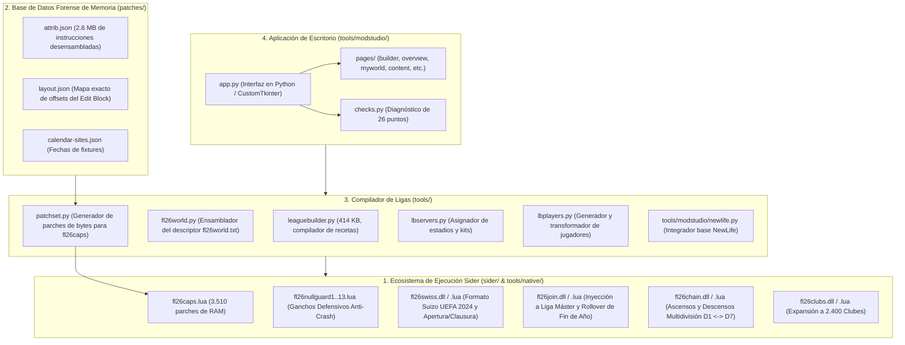

# ANÁLISIS TÉCNICO FORENSE: REPOSITORIO MATOZANATO (FootballLife-new-leagues)
**Repositorio:** `https://github.com/Matozanato/FootballLife-new-leagues`  
**Versión Auditada:** `modstudio-0.2.5.1` (Tag oficial más reciente, 30 de Octubre de 2026)  
**Autor:** Matozanato (Mata28)  
**Licencia:** MIT  
**Ubicación de Análisis:** `C:\Users\<usuario>\.gemini\antigravity\scratch\FootballLife-new-leagues`  

---

## 1. IDENTIDAD, ORIGEN Y OBJETIVO DEL PROYECTO

El proyecto **`FootballLife-new-leagues`** (y su aplicación gráfica de cabecera **`FL26 Mod Studio`**) fue creado para resolver una de las limitaciones históricas más frustrantes del motor de PES 2021 / SP Football Life: **la imposibilidad nativa de agregar nuevas ligas, países y divisiones en la Liga Máster sin sobreescribir las existentes**.

### La Premisa Técnica
En la comunidad de modding siempre se creyó que las ligas estaban "hardcodeadas en el ejecutable". La investigación de Matozanato demostró que esto era una verdad a medias:
1. **La definición de una liga es puramente datos:** Vive en 3 archivos binarios dentro de `pesdb`: `Competition.bin`, `CompetitionRegulation.bin` y `CompetitionEntry.bin`. Sider puede sobreescribir estos archivos en memoria en tiempo de ejecución mediante `livecpk`.
2. **El verdadero bloqueo vive en la memoria RAM del ejecutable:** Cuando arranca la Liga Máster, el juego reserva un bloque estático ("Edit Block", `0x1877068` bytes) con tablas de tamaño fijo (750 clubes, 1.300 entrenadores, 300 reglamentos y 13.000 partidos). Si se agregan más ligas, los datos superan el límite del bloque, el generador de fixtures produce cero partidos y el juego crashea con violaciones de acceso (`0xc0000005`).

La solución de Matozanato no parchea el archivo `.exe` en el disco ni repaquetea archivos CPK: **redefine la memoria en caliente** a través de Sider mediante scripts Lua (`fl26caps.lua`, `fl26slots250.lua`, `fl26nullguard*.lua`) y DLLs nativas en C compiladas con `zig cc` (`fl26swiss.dll`, `fl26join.dll`, `fl26chain.dll`, etc.).

---

## 2. ARQUITECTURA GENERAL DEL REPOSITORIO

El repositorio se compone de 4 subsistemas interactuando entre sí:



---

## 3. ANÁLISIS CARPETA POR CARPETA Y ARCHIVO POR ARCHIVO

### A. Carpeta `sider/` y `sider/experimental/` (Runtime de Memoria)

Esta carpeta contiene los módulos que se instalan en la carpeta `SiderAddons\modules\` de Football Life para inyectar parches en la RAM al iniciar el juego:

| Archivo | Tamaño | Propósito y Funcionamiento Técnico |
| :--- | :--- | :--- |
| **`fl26caps.lua`** | 506 KB | **El parche de capacidad maestro.** Aplica 3.510 modificaciones de bytes en la sección de código y datos del ejecutable en RAM. Aumenta la capacidad de: clubes (750 -> 2.400), entrenadores (1.300 -> 3.400), reglamentos (300 -> 600), jugadores (30.001 -> 61.905), fixtures (2.000 -> 8.000) y partidos por temporada (13.000 -> 65.000). Antes de escribir, verifica cada byte; si la firma no coincide, aborta de forma segura. |
| **`fl26joindll.lua` + `fl26join.dll`** | 24 KB / 96 KB | **Inyector de Liga Máster.** Intercepta la "puerta de la temporada" (`0x1413ac170`) y las rutinas `0x1413156e0` y `0x141343bf0`. Hace que las ligas creadas en IDs custom sean reconocidas por el generador de calendario y, al terminar la temporada o en Año Nuevo (para ligas con calendario sudamericano/asiático), cierra la competición para que no duplique puntos al año siguiente. |
| **`fl26nullguard.lua` al `fl26nullguard13.lua`** | ~80 KB (conjunto) | **Batería de 13 ganchos defensivos anti-cuelgues.** Corrigen bugs nativos de Konami en casos donde la base expandida deja punteros nulos o índices fuera de rango (ver detalle más abajo). |
| **`fl26regen.lua`** | 12.4 KB | Controla la regeneración de futbolistas retirados en la Liga Máster para que no se queden sin club o crasheen la cantera juvenil. |
| **`fl26regfast.lua`** | 5.4 KB | Optimizador de tiempo de carga: reduce hasta un 65% el tiempo que tarda la Liga Máster en procesar el cambio de mes en bases con más de 50 ligas activas. |
| **`experimental/fl26chain.dll` + `.lua`** | 92 KB / 19.6 KB | **Motor multidivisión en cascada.** Permite ascensos y descensos automáticos a través de pirámides de hasta 7 divisiones (D1 <-> D2 <-> D3 <-> D4...), sorteando el límite nativo de Konami que solo contempla intercambio entre 2 divisiones. |
| **`experimental/fl26swiss.dll` + `.lua`** | 427 KB / 52 KB | **Motor de torneos UEFA 2024 / Formato Suizo y Apertura/Clausura.** Intercepta el constructor genérico de fixtures (`0x1413f3e00`) para generar el calendario de 36 clubes con 8 rivales distintos (4 de local y 4 de visitante) para Champions, Europa y Conference League, o liguillas playoff de Apertura y Clausura. |
| **`experimental/fl26clubs.dll` + `.lua`** | 81 KB / 14.6 KB | Ensancha las tablas de búsqueda de clubes y aísla los equipos "no elegibles" del mercado de transferencias. |
| **`experimental/fl26slots250.lua`** | 21.4 KB | Expande la tabla estática de selección de competiciones a **250 slots concurrentes**, permitiendo que aparezcan todas en el menú de Partido Amistoso. |
| **`experimental/fl26slot7.lua`** | 14 KB | Expande el campo de slot de club a 8 bits (0..249), eliminando el límite de 124 competiciones seleccionables. |
| **`experimental/fl26reg128.lua`** | 15.2 KB | Expande las regiones/países de menú de 29 a 128, permitiendo que cualquier país nuevo tenga su propio encabezado con bandera en lugar de agruparse en "Otros". |
| **`experimental/fl26editlist.lua`** | 11.2 KB | Inyecta las ligas personalizadas en los menús desplegables del **Modo Editar** oficial de Konami. |
| **`experimental/fl26compcache.lua`** | 3.3 KB | **Parche anti-congelamiento del 31 de enero.** Evita que el juego se cuelgue al cambiar de año cuando coinciden el cierre del mercado de pases y el inicio del calendario sudamericano. |

---

### B. Carpeta `tools/native/` (Código Fuente en C)

Contiene el código fuente en C puro de las DLLs que se inyectan en Sider, compiladas con `zig cc -target x86_64-windows`:

1. **[fl26swiss.c](file:///C:/Users/Exevaz27/.gemini/antigravity/scratch/FootballLife-new-leagues/tools/native/fl26swiss.c)** (677 KB, 13.343 líneas):
   - Una obra maestra de ingeniería inversa. Reemplaza el generador clásico de todos contra todos (`round robin`) por el algoritmo suizo de la UEFA.
   - Sortea 36 equipos divididos en 4 bombos de 9, asignando exactamente 2 rivales por bombo (4 partidos de local y 4 de visitante = 144 partidos en total).
   - Administra torneos Apertura y Clausura dividiendo la temporada en dos fases independientes con liguilla final de 8 o 4 equipos.
2. **[fl26join.c](file:///C:/Users/Exevaz27/.gemini/antigravity/scratch/FootballLife-new-leagues/tools/native/fl26join.c)** (100 KB, 1.992 líneas):
   - Intercepta `0x141343bf0` y `0x1413ac170`. Añade los IDs de reglamentos creados a la lista de competiciones activas de la temporada y registra los cierres de año para competiciones sudamericanas/asiáticas (`0x141363210`).
3. **[fl26chain.c](file:///C:/Users/Exevaz27/.gemini/antigravity/scratch/FootballLife-new-leagues/tools/native/fl26chain.c)** (45 KB, 858 líneas):
   - Intercepta `0x14135bff0` (`apply`) y `0x141522b50` (`set_regulation_teams`).
   - Lee las tablas finales de posiciones de las divisiones intermedias (ej. B y C), extrae los clubes que descienden de la división superior y los que ascienden de la inferior, y actualiza los punteros de equipo sin alterar el tamaño de las ligas.

---

### C. Carpeta `tools/` (El Compilador de Ligas en Python)

Esta carpeta es el núcleo de compilación de datos fuera del juego:

1. **`leaguebuilder.py`** (414 KB, 7.802 líneas):
   - El motor compilador central. Recibe una "receta de mundo" (`world.json`), lee los archivos `.bin` del juego (o de NewLife), valida colisiones de IDs, calcula calendarios, asigna escudos, uniformes y estadios, y empaqueta la carpeta `livecpk`.
   - Soporta ligas de 10 a 28 clubes, partidos de 1 a 4 ruedas, ligas con división escocesa (split regular + grupos campeonato/descenso) y torneos Apertura/Clausura.
2. **`fl26world.py`** (37 KB):
   - Genera el descriptor de texto `fl26world.txt`, que Sider y las DLLs leen al arrancar para saber qué ligas existen, qué ascensos tienen, qué calendarios usan y qué plazas a copas continentales otorgan.
3. **`patchset.py`** (96.8 KB):
   - Analiza `patches/attrib.json` y `patches/layout.json` y emite el script `fl26caps.lua` con los 3.510 parches binarios listos para Sider.
4. **`lbservers.py`** (48.6 KB) y **`lbstadiums.py`** (18 KB):
   - Mapeadores automáticos de `stadium-server` y `kit-server`. Asocian estadios y uniformes a los equipos generados editando los archivos `map_teams.txt` y `map.txt`.
5. **Suite de Pruebas Automatizadas (`test_*.py`)**:
   - Más de 100 scripts de pruebas unitarias y de integración que verifican la integridad de dorsales, posiciones, fechas de calendario, desbordes de memoria y compatibilidad con partidas guardadas.

---

### D. Carpeta `tools/modstudio/` (La Aplicación de Escritorio)

La interfaz gráfica oficial distribuida como `FL26ModStudio.exe`:

- **Tecnología:** Python 3 con `CustomTkinter` y `Tkinter`, empaquetada con PyInstaller.
- **`app.py`** (61.4 KB): Ventana principal con barra de navegación lateral, selector de temas y enrutamiento de páginas.
- **`checks.py`** (31.5 KB): Motor de diagnóstico de 26 puntos (Rutas, Sider.ini, Despliegue, Paquetes, Logs, EDIT).
- **`pages/builder.py`** (271 KB): Interfaz visual para armar pirámides y ligas desde la base NewLife o desde cero.
- **`pages/myworld.py`** (48.5 KB) y **`worlds.py`** (42 KB): Gestor de universos ("Mundos"). Permite crear un mundo nuevo, clonar el actual o alternar entre ellos intercambiando la carpeta `save` (partidas y EDIT) y la carpeta `pesdb`.
- **`pages/players.py`** (76.6 KB): Editor de jugadores con búsqueda, edición de estadísticas y traspasos.

---

## 4. ANÁLISIS DE LAS NOVEDADES CLAVE DE LA VERSIÓN 0.2.5.1

La versión más reciente auditada (`0.2.5.1`) incluye defensas de ingeniería inversa críticas:

### 1. `fl26nullguard12.lua` (Crash en el Bucle de Fatiga de Jugadores Eliminados)
- **El problema:** En la Liga Máster, al avanzar el calendario, una rutina (`0x141321cf8`) recorre los jugadores de cada equipo para sumar fatiga/moral en un campo de 7 bits (`+0x13c`, bits 18..24). Llama a `0x1414bc9a0` para obtener el puntero del jugador; si el jugador fue eliminado o desvinculado en un parche previo, la función devuelve `NULL` (`rax = 0`). La siguiente instrucción (`mov ecx, [rax+0x13c]`) provocaba un crasheo instantáneo (`Access Violation`).
- **El fix:** Reescribe 72 bytes en `0x141321d00` agregando un test previo:
  ```x86asm
  141321d00  test rax, rax
  141321d03  je   0x141321d48    ; Si el jugador no existe, salta al siguiente sin crashear
  ```

### 2. `fl26nullguard13.lua` (Crash por Underflow en la Copa Amistosa de Pretemporada)
- **El problema:** A fines de diciembre, la Liga Máster elige los clubes para la copa amistosa de pretemporada (reglamento 106). La función `0x141359a60` toma candidatos desde el final de una lista. Si en ligas personalizadas hay menos candidatos que plazas disponibles, el bucle seguía retrocediendo por debajo del inicio de la lista y leía la dirección `-4`, provocando un crasheo fatal en `0x14135a384`.
- **El fix:** Intercepta la cabecera del bucle en `0x14135a379` e inserta una comparación con el puntero de inicio de la lista (`cmp rax, [rbp-0x41]; jbe exit`), saliendo de forma limpia si se acaban los candidatos.

---

## 5. CAPACIDADES Y LIMITACIONES DE `FootballLife-new-leagues`

### ¿Qué PUEDE hacer?
1. **Ligas Masivas:** Admite hasta 28 clubes por liga, torneos de 1 a 4 ruedas y pirámides de hasta 7 divisiones con ascensos/descensos reales.
2. **Formatos Modernos:** Soporta el nuevo formato suizo de 36 clubes para torneos UEFA (Champions, Europa y Conference League) y torneos estilo Apertura/Clausura.
3. **Múltiples Mundos:** Permite alternar entre diferentes instalaciones/parches sin mezclar partidas de Liga Máster ni archivos EDIT.
4. **Respaldo de Memoria Impecable:** Protege la ejecución con 13 Null-Guards y expande el heap de memoria en RAM para 2.400 clubes y 61.905 jugadores.

### ¿Qué NO PUEDE hacer o qué limitaciones tiene?
1. **Flujo Basado en "Compilación de Recetas":** No permite editar un equipo o un jugador suelto en tiempo real sobre la base activa; cada cambio requiere re-ejecutar el pipeline de `leaguebuilder.py` o Mod Studio para regenerar el paquete.
2. **Dependencia Fuerte de Football Life:** Gran parte de los offsets de memoria en `attrib.json` y `layout.json` están calculados específicamente para el ejecutable `FL_2026.exe`. Aunque comparten el motor de PES 2021, algunos desplazamientos difieren del `PES2021.exe` original de Steam.
3. **No tiene extractor gráfico de CPK nativo:** Depende de que el usuario tenga los `.bin` ya exportados o use scripts de terminal en Python.
4. **Peso y Dependencias:** La aplicación de escritorio Mod Studio empaqueta el runtime completo de Python y librerías gráficas pesadas (pesando más de 80 MB comprimida y consumiendo bastante memoria en reposo).

---

## 6. COMPARATIVA FORENSE: MATOZANATO vs. TU NUEVA APP (`PES2021EditorWeb`)

| Aspecto | `Matozanato / FootballLife-new-leagues` | Tu Nueva App (`PES2021EditorWeb` en `<carpeta-del-programa>`) |
| :--- | :--- | :--- |
| **Público y Juego Objetivo** | **SP Football Life 2026** exclusivamente. | **eFootball PES 2021 Original** (con selectores para FL o portables). |
| **Tecnología y Lenguajes** | Python 3 + CustomTkinter + C (Zig) + Lua. | **C# (.NET 4.0 WinForms)** + **HTML5/JS (WebView2)**. |
| **Velocidad y Dependencias** | Pesada (PyInstaller exe ~90 MB, arranque lento en Python). | **Ultra liviana (536 KB el exe)**, inicio instantáneo en C# nativo. |
| **Modelo de Edición** | **Batch / Receta:** Se define un JSON y se compila todo el mundo desde cero. | **Relacional en Vivo:** Se navega la base, se editan datos en pantalla y se guarda al instante. |
| **Extracción de CPK** | Por scripts de terminal Python (`cpkread.py`). | **Integrada y Nativa con 1 clic** en C# (`CpkExtractor.cs`). |
| **Gestión del Archivo EDIT** | Solo intercambio de carpeta de save. | **Descifrado MT19937, lectura y desbloqueo de SID de Windows** (`PesCrypt.cs`). |
| **Ecosistema de Sider** | Desarrolló los módulos C y Lua (`fl26swiss`, `fl26chain`, etc.). | **Reutiliza y despliega automáticamente** estos módulos vía [`SiderLuaGenerator.cs`](file:///E:/app-web/src/logic/SiderLuaGenerator.cs). |
| **Ganchos Anti-Crash** | Cuenta con 13 Null-Guards (actualizado a `nullguard13.lua`). | Cuenta con los primeros 11 Null-Guards en su generador Lua. |

---

## 7. OPORTUNIDADES DIRECTAS PARA TU PROGRAMA

Tras esta auditoría profunda del repositorio de Matozanato, hay **dos mejoras inmediatas de altísimo valor** que podemos incorporar a tu nueva app en `<carpeta-del-programa>`:

1. **Incorporar los dos nuevos Null-Guards (12 y 13):**  
   Podemos agregar las rutinas de `fl26nullguard12.lua` y `fl26nullguard13.lua` dentro de tu [`SiderLuaGenerator.cs`](file:///E:/app-web/src/logic/SiderLuaGenerator.cs) para que tu generador de Sider proteja también contra los crasheos de fatiga de jugadores eliminados y el error de pretemporada en diciembre.
2. **Sincronizar las DLLs actualizadas de `tools/native/`:**  
   Podemos actualizar las versiones precompiladas de `fl26chain.dll` (que ahora admite hasta 32 cadenas en lugar de 8) y `fl26join.dll` dentro de la carpeta de módulos de tu editor para garantizar la máxima estabilidad en carreras largas de Liga Máster.
